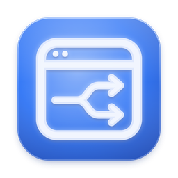
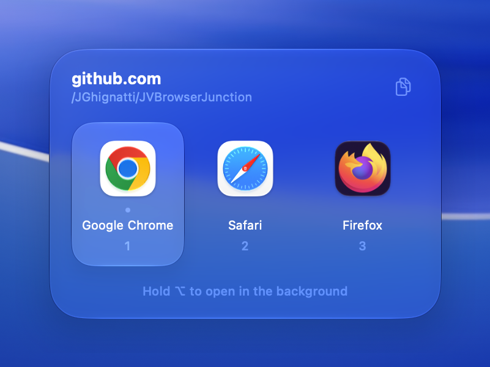

  

<h1 align="center">JV Browser Junction</h1>

  <em>Choose which browser opens each link you click</em>

  
  
  

JV Browser Junction lives in the menu bar and acts as your default browser. Click a link anywhere on your Mac and a picker appears, so you choose which browser opens it. Hold <kbd>option</kbd> to open it in the background. From Settings, you can reorder or hide browsers and choose where the picker appears.

## Installation

1. Download the latest build from the [Releases page](https://github.com/JGhignatti/JVBrowserJunction/releases/latest).
2. Move `JVBrowserJunction.app` to `/Applications`.
3. Launch it, choose **Set as Default Browser…** from its menu bar icon, and confirm.

Requires macOS 14 Sonoma or later.

## Building from source

1. Clone the repository.
2. Open `JVBrowserJunction.xcodeproj` in Xcode.
3. Build and run the `JVBrowserJunction` scheme.

Built with [Defaults](https://github.com/sindresorhus/Defaults) and [LaunchAtLogin](https://github.com/sindresorhus/LaunchAtLogin-Modern) by Sindre Sorhus.

Maintainers cutting a new version should see [RELEASING.md](RELEASING.md).

## License

[MIT](LICENSE) © [João Ghignatti](https://github.com/JGhignatti)
